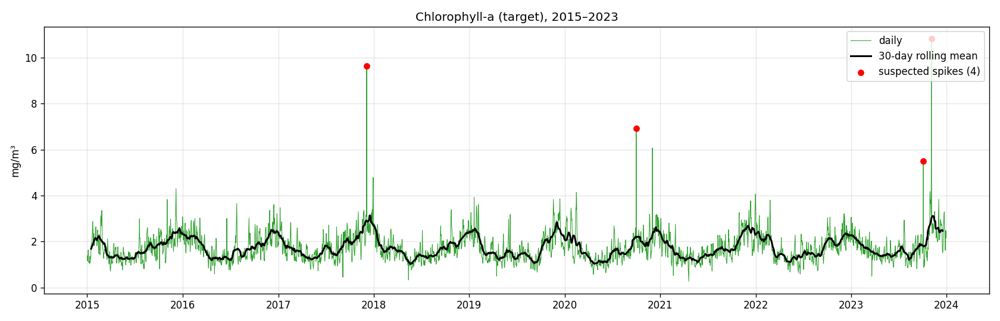
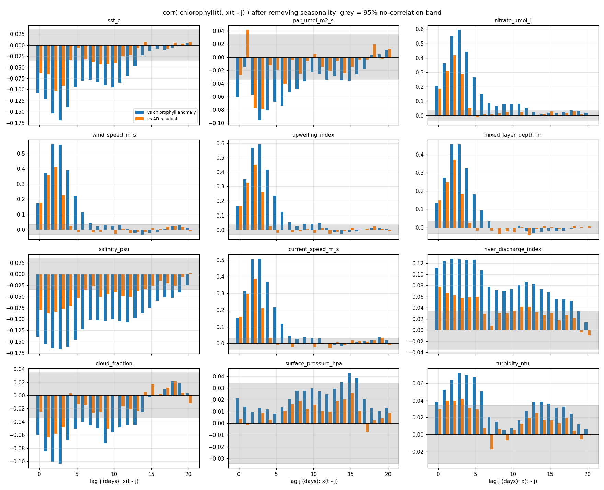
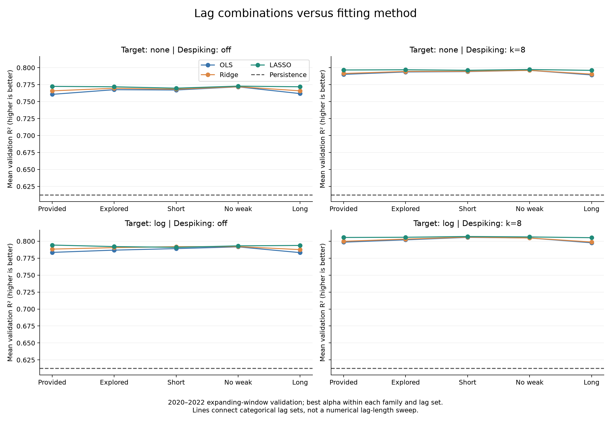
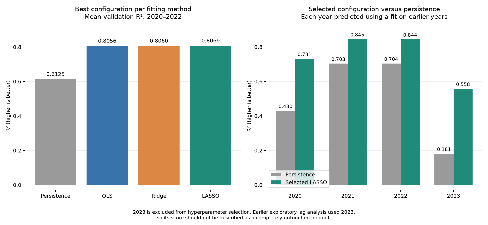

# One-Day-Ahead Chlorophyll-a Forecasting

Forecasting tomorrow's chlorophyll-a concentration at a coastal monitoring station with a
linear **ARX** (auto-regressive with exogenous inputs) model, using chronological validation
and fully explicit preprocessing.

Course project for *Machine Learning* (Instituto Superior Técnico, 2026/2027), Part I: Regression.

**Result:** mean validation R² of **0.807** (2020–2022) against **0.612** for a persistence
baseline ("tomorrow = today").



## The problem

For each day *t*, predict chlorophyll-a *y(t)* in mg/m³ using only what is known on that day:

- all past observations, including past chlorophyll *y(t−1), y(t−2), …*
- today's 12 environmental measurements (sea-surface temperature, light, nitrate, wind,
  upwelling, mixed-layer depth, salinity, currents, river discharge, cloud cover, pressure,
  turbidity)
- **not** today's chlorophyll; using it (lag 0) would leak the answer

The model has the ARX form

```
y(t) = c + Σᵢ aᵢ·y(t−i) + Σₖ Σⱼ bₖⱼ·xₖ(t−j) + e(t)
```

plus `sin` and `cos` of the day of year to encode the annual cycle without a jump at New Year.

The released data covers 2015–2023 (3,287 days). The course's hidden test set is 2024.
The synthetic dataset reproduces typical problems of environmental series: strong
seasonality, correlated predictors, delayed effects and occasional retrieval errors.

## Approach

### 1. Exploration: which lags matter?
After removing each variable's seasonal cycle and replacing the obvious spikes, we measured
lagged correlations:

- **Chlorophyll's own memory is short.** The partial autocorrelation is +0.72 at lag 1 and
  −0.14 at lag 2, and close to zero after that.
- **A "storm" signal arrives 2–3 days later.** Wind, upwelling, nitrate, current speed and
  mixed-layer depth are strongly inter-correlated (0.7–0.9). They peak at lags 2–3 and fade
  by about day 5, consistent with *wind → upwelling → nutrients → phytoplankton growth*.
- SST, light, salinity, river discharge, cloud and turbidity have weak effects. Surface
  pressure has none.



### 2. Preprocessing (all explicit NumPy/Pandas)
- **Despiking.** A value more than *k* robust standard deviations (1.4826 × MAD) from a
  31-day rolling median is replaced by that median. Lag inputs use a **past-only** window, so
  training and real-time prediction see identical features. Training labels use a centred
  window computed on the training years only.
- **Log target** with Duan's smearing correction when transforming back to mg/m³.
- **Standardization** with means and standard deviations learned on training rows only.
  Predictions are clipped at ≥ 0.

### 3. Model selection
We compared 220 configurations: 5 lag sets × 2 target transforms × 2 despiking options ×
11 estimators (OLS, Ridge with 5 penalties, LASSO with 5 penalties).

Validation uses **expanding windows**: train on 2015–2019 and validate on 2020, train on
2015–2020 and validate on 2021, train on 2015–2021 and validate on 2022. The score is the mean
R², always measured against the raw (uncleaned) values.



## Results

Selected model: **LASSO (α = 0.0003)** on log-chlorophyll with despiking (k = 8) and 42
features (chlorophyll lags 1–3, storm variables lags 0–4, weak variables lags 0–1, seasonal
terms). LASSO kept 31 of the 42 coefficients.

| | Mean val. R² | RMSE (mg/m³) | MAE (mg/m³) |
|---|---|---|---|
| Persistence baseline | 0.612 | 0.384 | 0.240 |
| OLS | 0.806 | 0.272 | 0.168 |
| Ridge (α = 10) | 0.806 | 0.272 | 0.167 |
| **LASSO (α = 0.0003)** | **0.807** | **0.271** | **0.167** |



**Main findings**

- **Preprocessing mattered more than the estimator.** The log target plus despiking raised
  the best R² from 0.773 to 0.807. OLS, Ridge and LASSO all finished within 0.0013 of each
  other.
- **Short lags are enough.** All five lag sets scored between 0.805 and 0.807, so the
  42-feature model matches the 133-feature default.
- **2023 shows the limit of any forecast.** On 2023 the model reached R² 0.558, against 0.181
  for persistence. Two single-day retrieval spikes (5.5 and 10.8 mg/m³) account for 79% of the
  squared error. Without those two days, R² is 0.838. 2023 was excluded from hyperparameter
  selection, but the exploratory lag analysis used it, so it is not a fully untouched holdout.

## Repository structure

```
best_model/
  my_model.py        load_model() and predict(): the prediction interface
  utils.py           feature code shared by training and prediction
  model.pkl          fitted model (plain coefficients, means and scales; no sklearn objects)
training_code/
  train.py           model search, final fit, saves model.pkl, checks predict() consistency
  model_selection_results.csv   all 220 configurations and their validation scores
  exploration/       time-series and lag-correlation plots
  comparisons/       comparison plots and summary tables
figures/             figures used in this README
data/                place the dataset here (not included)
```

`utils.py` is imported by both `train.py` and `my_model.py`, so features are built by the same
code at training and prediction time. `train.py` checks this by comparing `predict()`
day by day with its own batch predictions.

## How to run

The dataset (`chlorophyll_student_2015_2023.csv`) was provided by the course and is not
redistributed here. Place it in `data/` folder before running the command below.

```bash
python3.11 -m venv .venv
source .venv/bin/activate
pip install --only-binary=:all: -r requirements-dev.txt   # or requirements.txt without plots

# train: model search (about 1 minute), final fit and consistency check
python training_code/train.py --data data/chlorophyll_student_2015_2023.csv --output best_model/model.pkl

# optional plots
python training_code/exploration/plot_time_series.py
python training_code/exploration/plot_lag_correlations.py
python training_code/comparisons/plot_model_comparisons.py --data data/chlorophyll_student_2015_2023.csv
```

Predicting one day:

```python
import sys; sys.path.insert(0, "best_model")
import pandas as pd, my_model

model = my_model.load_model("best_model/model.pkl")
df = pd.read_csv("data/chlorophyll_student_2015_2023.csv")
history = df.iloc[:-1]                                         # everything before the day
today = df.iloc[[-1]].drop(columns=["chlorophyll_a_mg_m3"])    # that day's predictors only
print(my_model.predict(model, history, today))                 # -> array([1.852])
```

Requirements: Python 3.9–3.13 (3.11 recommended), numpy, pandas < 3, scipy, openpyxl,
scikit-learn 1.6.1.

## Authors

- **Mohammed Abdullahi**: model training and fitting, R² evaluation
- **Pedro de Salas Millán**: data exploration, lag research, final model loading


The assignment and dataset were created by the course teaching team. AI assistants were used
during development, as declared in the course submission.
